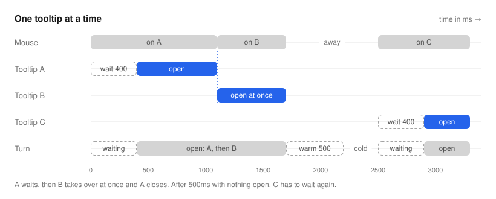

# tooltip-turn

One tooltip on the page at a time, the way a Mac does it, in about 1 KB minified and gzipped. No
dependencies.

[Demo](https://cameronspears.github.io/tooltip-turn/demo/) (rest on a button, slide along the row, then try the row without it)

```bash
npm install tooltip-turn
```

```js
import { tooltipTurn as turn } from 'tooltip-turn';

const button = document.querySelector('#save');
const tip = document.querySelector('#save-tip');

turn.subscribe(() => {
  tip.hidden = !turn.stage(button).startsWith('open');
});
button.addEventListener('pointerenter', () => turn.ask(button, button));
button.addEventListener('pointerleave', () => turn.leave(button));
button.addEventListener('focus', () => turn.ask(button, button));
button.addEventListener('blur', () => turn.leave(button));
```

Do the same for every tooltip on the page. They all share `tooltipTurn`, so only one is ever seen.

Or in React:

```jsx
import { useTooltipTurn } from 'tooltip-turn/react';

function SaveButton() {
  const tip = useTooltipTurn('save-tip');
  return (
    <>
      <button {...tip.anchorProps}>Save</button>
      <div {...tip.tooltipProps} hidden={!tip.visible}>
        Save your changes
      </div>
    </>
  );
}
```

## How it behaves

<picture>
  <source media="(prefers-color-scheme: dark)" srcset="https://raw.githubusercontent.com/cameronspears/tooltip-turn/main/.github/assets/timing-dark.svg" />
  
</picture>

The whole page shares one turn, and only the tooltip that has it is shown. The first one a mouse
rests on waits 400 ms, so a mouse passing over a toolbar doesn't set tooltips off. Moving to another
anchor while it waits starts the wait again, so a quick sweep opens nothing.

Once one is open, the next opens as soon as you reach its anchor, and the open one goes. After the
last one closes, the next still opens at once for 500 ms. Then it goes back to waiting.

A click, a tap or a key never waits, because the person asked. While anyone is subscribed, the store
listens for `pointerdown`, `keydown`, `pointerover` and `pointerout` on `window` to tell a passing
mouse from a press. Pressing the anchor you're resting on opens its tooltip straight away.

Touch sends `pointerleave` as soon as the finger lifts, which would close the tooltip again. So for
taps, handle enter and leave for the mouse only, and ask on `pointerdown` with `{ hover: false }`,
which never waits:

```js
button.addEventListener('pointerenter', (e) => e.pointerType === 'mouse' && turn.ask(button, button));
button.addEventListener('pointerleave', (e) => e.pointerType === 'mouse' && turn.leave(button));
button.addEventListener('pointerdown', (e) => {
  if (e.pointerType !== 'mouse') turn.ask(button, button, { hover: false });
});
```

Each tooltip reads its own stage: `off`, `waiting`, `open`, `open-quick` or `replaced`. Show it only
for `open` and `open-quick`. If you fade tooltips, `open-quick` means it took over from another and
can come in faster, and `replaced` means it just lost the turn and should go at once, with no fade,
so two are never seen together.

[demo/index.html](demo/index.html) is a full hand-rolled example, with taps, Escape and
click-outside.

## React

`useTooltipTurn(id)` takes the tooltip element's id. Its `anchorProps` handle the mouse, focus and
blur, and point the anchor at the tooltip with `aria-describedby`. A tap opens the tooltip, and a
second tap closes it. While it's open, Escape or a press anywhere else closes it. It leaves the turn
when the component unmounts.

React is an optional peer dependency. The core never imports it.

## With react-tooltip or Floating UI

Let the library place and draw the tooltip, and let tooltip-turn decide when it shows.

Set the library's own show delay to 0. The wait lives in tooltip-turn. A second delay in the library
would add to it, and the hand-off from one tooltip to the next would no longer be instant.

Keep the library's tooltip mounted and hide it with CSS while it isn't its turn, for example
`opacity: 0; pointer-events: none`. The library still thinks it's open. You only keep it out of
sight until its turn.

With react-tooltip, use its `setIsOpen` callback:

```jsx
import { Tooltip } from 'react-tooltip';
import { tooltipTurn } from 'tooltip-turn';
import { useTooltipTurn } from 'tooltip-turn/react';

const tip = useTooltipTurn('save');

<Tooltip
  id="save"
  delayShow={0}
  setIsOpen={(open) =>
    open ? tip.ask(tooltipTurn.findAnchor('[data-tooltip-id="save"]')) : tip.leave()
  }
  className={tip.visible ? '' : 'off-stage'}
/>;
```

With Floating UI, call `tip.ask(anchor)` and `tip.leave()` from `onOpenChange`, and drop
`FloatingDelayGroup`, since tooltip-turn does that job.

When the library doesn't tell you the anchor, `findAnchor(selector)` returns the matching element
under the pointer, or else the focused one. If an anchor has nothing to show, don't ask for the
turn, or an empty tooltip will take it from a real one.

## Options

`createTooltipTurn(options)` makes a turn with other delays:

- `coldDelay` (default `400`): how long in ms a mouse rests on an anchor before the first tooltip
  opens.
- `coolDown` (default `500`): how long in ms after the last tooltip closes the next still opens at
  once.

Tooltips only take turns with others on the same turn, so share one. `tooltipTurn` is the page's
shared turn with the defaults. In React, pass your own with `useTooltipTurn(id, { store })`.

A turn has `subscribe`, `getState`, `stage(owner)`, `ask(owner, anchor, { hover })`,
`leave(owner)` and `findAnchor(selector)`. An owner can be anything that names one tooltip, compared
with `===`. Its shape fits React's `useSyncExternalStore`.

On the server every stage is `off`, so it's safe in SSR frameworks.

## Alternatives

Floating UI's `FloatingDelayGroup` and Radix's `Tooltip.Provider` do the same job inside their own
libraries. If every tooltip on your page already uses one of them, use theirs. tooltip-turn is for
pages that mix libraries, use react-tooltip, or draw their own tooltips.

It only decides when a tooltip shows. It doesn't place, draw or animate it. It's built for hover
tooltips: menus and popovers that people open on purpose shouldn't share the turn.

## License

MIT
